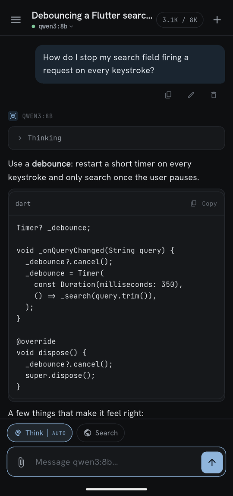
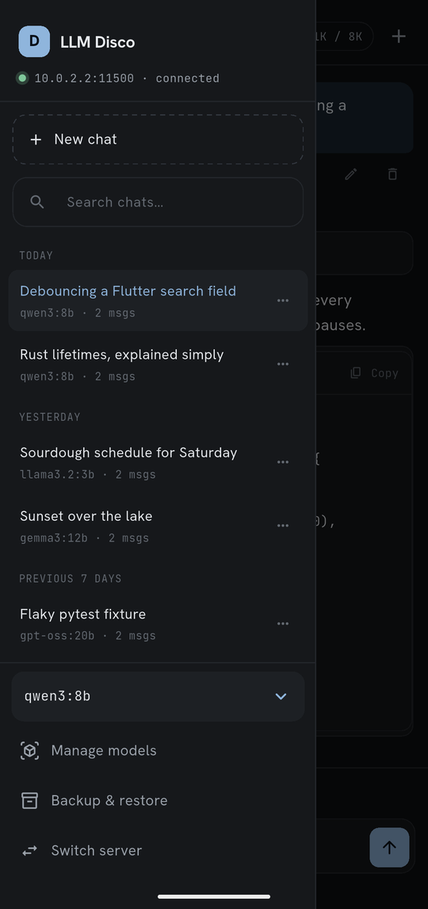
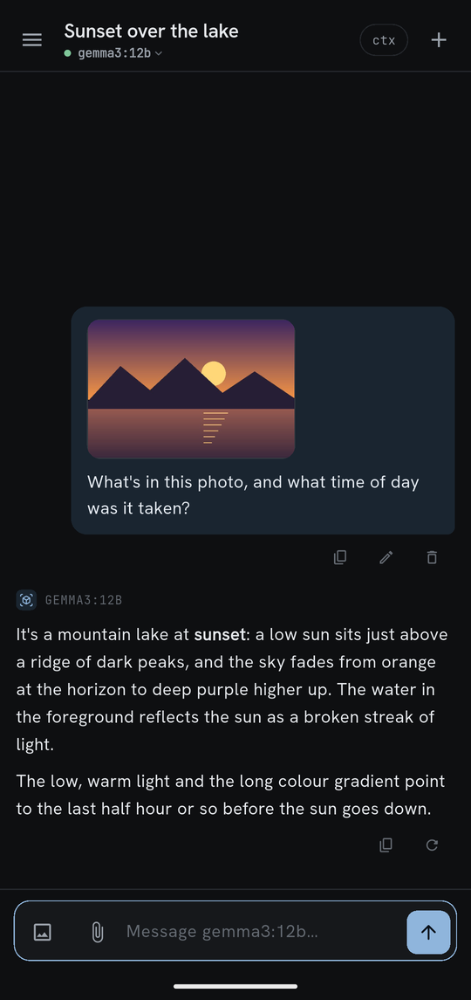
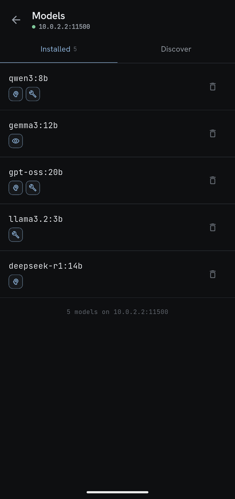
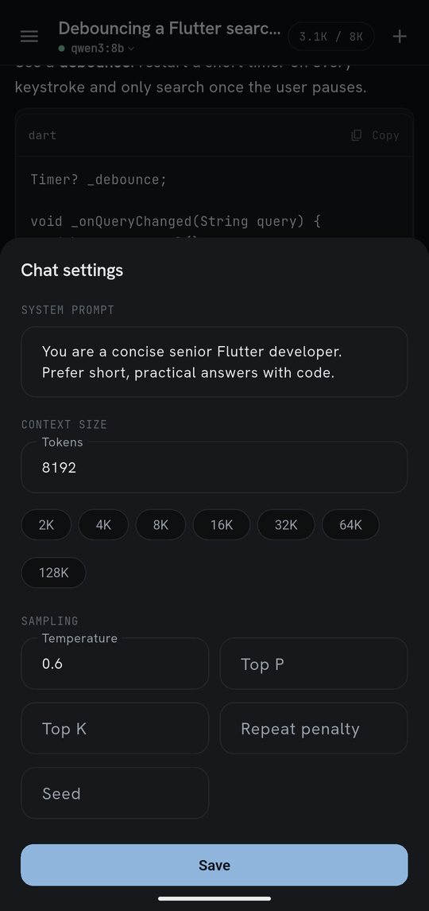
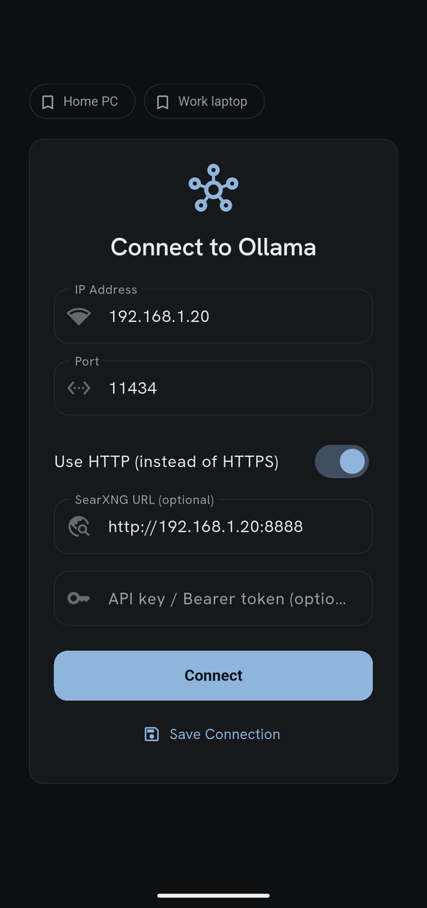

# LLM Disco

A Flutter mobile app for chatting with locally-hosted large language models via [Ollama](https://ollama.com). Run your favourite model on your PC and talk to it from your phone over your home network.

Built as my Final Year Project at Maynooth University (BSc Computer Science, 2025–2026).

---

## Screenshots

<p align="center">
  
  
  
</p>
<p align="center">
  
  
  
</p>
<p align="center"><sub>Sample conversations, on the Android emulator.</sub></p>

## Features

- **Real-time streaming chat** - tokens appear as they are generated
- **Model selection** - switch between any model installed on your Ollama server
- **Image & file attachments** - send photos or files to vision-capable models
- **Extended thinking mode** - see the model's reasoning process, with adjustable effort levels
- **Web search** - models can search the web via a self-hosted SearXNG instance using tool-calling
- **Model management** - browse, download, and delete models directly from the app
- **Conversation management** - rename chats, edit & resend messages, export as Markdown or JSON, undo a swipe-delete
- **Drafts per chat** - a half-written message and its attachments stay with the chat they belong to
- **Conversation persistence** - chats are saved locally with crash-safe writes and a backup fallback
- **Multiple server profiles** - save and switch between Ollama instances; re-saving a name updates it
- **Optional auth token** - for Ollama behind an API-key/Bearer proxy; never sent to third-party services
- **Dark theme** with code blocks that carry a language label and copy button
- **Accessible** - every control is labelled for screen readers, and small icons have enlarged touch areas
- **Works on a LAN with no internet** - fonts are bundled, and the app only talks to your Ollama server (plus ollama.com when you browse models, and your SearXNG instance if you use web search)

## Requirements

- Android 7.0 or newer (iOS is untested; the iOS project is missing the camera and local-network permissions it would need)
- A PC on the same local network running [Ollama](https://ollama.com) with at least one model installed, set up to accept connections from other devices (see below)
- *(Optional)* A self-hosted [SearXNG](https://docs.searxng.org/) instance for web search

## Getting Started

```bash
git clone https://github.com/shamanchikq/llm_disco.git
cd llm_disco
flutter pub get
flutter run
```

On first launch, enter your PC's local IP address and the Ollama port (default `11434`), then tap **Connect**. Enter just the address (for example `192.168.1.20`) — no `http://` and no port; HTTP vs HTTPS is a toggle and the port has its own field.

## Setting up Ollama on your PC

By default Ollama only listens on `127.0.0.1`, so your phone can't reach it. Make it listen on your network by setting `OLLAMA_HOST=0.0.0.0:11434`, then restart Ollama:

- **Linux (systemd install)** — run `sudo systemctl edit ollama.service`, add the lines below, then `sudo systemctl daemon-reload && sudo systemctl restart ollama`:

  ```ini
  [Service]
  Environment="OLLAMA_HOST=0.0.0.0:11434"
  ```

- **macOS (Ollama app)** — run `launchctl setenv OLLAMA_HOST "0.0.0.0:11434"`, then quit and reopen Ollama.
- **Windows** — add a user environment variable `OLLAMA_HOST` with the value `0.0.0.0:11434` (Settings → "Edit environment variables for your account"), then quit Ollama from the system tray and start it again.

Then:

1. **Open the port** if your PC runs a firewall: allow inbound TCP `11434` (for example `sudo ufw allow 11434/tcp` on Ubuntu; on Windows, allow Ollama through Windows Defender Firewall when prompted).
2. **Find the PC's local IP** with `ip addr` (Linux), `ipconfig getifaddr en0` (macOS) or `ipconfig` (Windows), and enter it in the app.
3. **Check it from the phone's network** — `http://<pc-ip>:11434` in the phone's browser should say "Ollama is running".

Ollama has no authentication of its own, so `0.0.0.0` exposes it to everyone on that network. Only do this on a network you trust; to reach Ollama from anywhere else, put it behind a reverse proxy that checks an API key, and enter that key in the app's token field.

## Build APK

```bash
flutter build apk --split-per-abi
```

This produces one APK per CPU architecture in `build/app/outputs/flutter-apk/`. Install `app-arm64-v8a-release.apk` on a modern phone (about 19 MB, against 56 MB for the single universal APK that a plain `flutter build apk` produces); `app-armeabi-v7a-release.apk` covers older 32-bit phones and `app-x86_64-release.apk` the Android emulator.

Release builds are signed with the key described in `android/key.properties` (not in the repository). Without that file the build falls back to the debug key, which is fine for installing on your own phone but not for publishing.

## Project Structure

```
lib/
  screens/       # ConnectionScreen, MainScreen, ModelManagementScreen
  providers/     # ChatProvider, ConnectionProvider, ModelProvider
  services/      # OllamaService (HTTP), StorageService (JSON persistence)
  models/        # ChatMessage, Conversation, ModelCapabilities, OllamaSearchResult
  widgets/       # MessageBubble, ChatInput, ChatSidebar, ModelSelector, CodeBlockBuilder
  theme/         # App theme, custom ThemeExtensions and bundled-font setup
assets/
  google_fonts/  # Hanken Grotesk and JetBrains Mono (OFL), bundled
test/            # Unit tests, widget tests, screen tests
```

## Tech Stack

- **Flutter / Dart** - UI and app logic
- **Provider** - state management
- **http** - streaming HTTP for Ollama API
- **flutter_markdown_plus** - markdown rendering in chat (maintained fork of `flutter_markdown`)
- **image_picker / file_picker** - attachments
- **path_provider** - local JSON storage
- **share_plus** - exporting chats
- **url_launcher** - opening links from replies and search results
- **google_fonts** - typography, served from the bundled font files

## Privacy

- Conversations, server profiles and the optional auth token are stored on the phone only. The token is kept in plain text in the app's private storage, and is excluded from Android cloud backup and device-to-device transfer (chats are still included, so they move to a new phone).
- Model output is treated as untrusted: images in replies are never loaded automatically (they show as a placeholder you can tap), and links open only if they are ordinary `http`/`https` links.

## Note on Commit History

The repository was created partway through development, so the early design and prototyping work is not reflected in the commit history. Active development ran from late 2024; commits start from February 2026.
